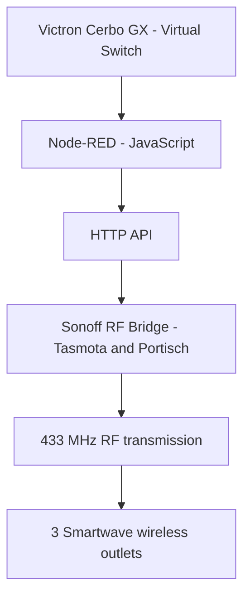

# RF Smart Switching – Sonoff & Victron

### 433 MHz RF Control | Embedded Systems | Home Automation

**Independent integration project — Sonoff RF Bridge, Tasmota, Node-RED and Victron Venus OS**

## Project overview

Developed and tested a wireless switching integration that allows Smartwave/KlikAanKlikUit 433 MHz power outlets to be controlled from a Victron Cerbo GX touchscreen interface.

The project combines RF signal analysis, embedded firmware configuration, HTTP communication and Node-RED automation.

## Technologies

- **Hardware:** Sonoff RF Bridge R2 V2.2, ESP32, RTL-SDR
- **Firmware:** Tasmota and Portisch RF firmware
- **RF analysis:** 433.92 MHz, rtl_433, RF pulse timing
- **Automation:** Node-RED, JavaScript
- **Communication:** HTTP API, RF transmission
- **Platform:** Victron Cerbo GX, Venus OS, virtual switches

## Engineering work

- Flashed the RF microcontroller using an ESP32 programming interface.
- Captured and analyzed original remote-control RF transmissions.
- Converted recorded RF signals into working transmit commands.
- Diagnosed communication issues between the Sonoff bridge and Victron Cerbo GX.
- Implemented HTTP-based control using Node-RED.
- Integrated wireless switching into the Victron user interface.
- Tested switching operations against physical hardware.

## Verified results

**Three Smartwave/KlikAanKlikUit outlets successfully controlled via Node-RED and Victron virtual switches.**

A fourth outlet remains to be configured and tested.

## Example – Node-RED JavaScript

```javascript
const value = msg.payload;
const on = value === 1 || value === true || value === "ON";
const off = value === 0 || value === false || value === "OFF";

if (!on && !off) return null;

msg.payload = on ? "ON" : "OFF";
return msg;
```

This simplified example demonstrates the handling of switch commands. Actual RF codes, device addresses and network configuration are intentionally excluded.

## Project documentation

Demonstration screenshots and an architecture overview will be added.

**Note:** This repository is a technical showcase. It does not contain the complete production configuration, RF transmit codes or private network information.


## System architecture


  
